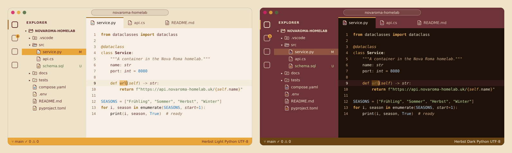
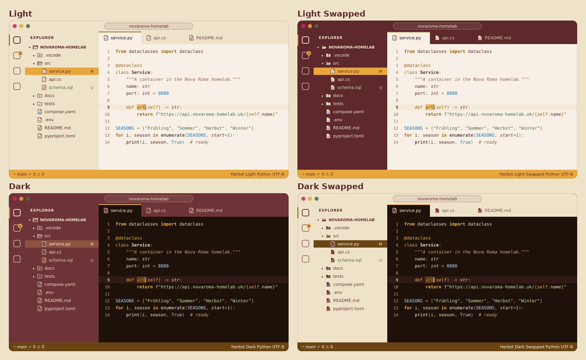
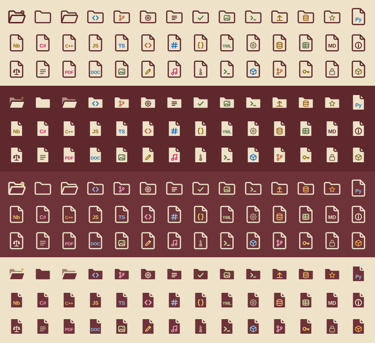
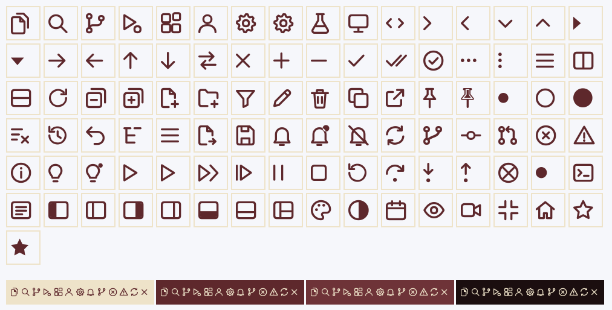
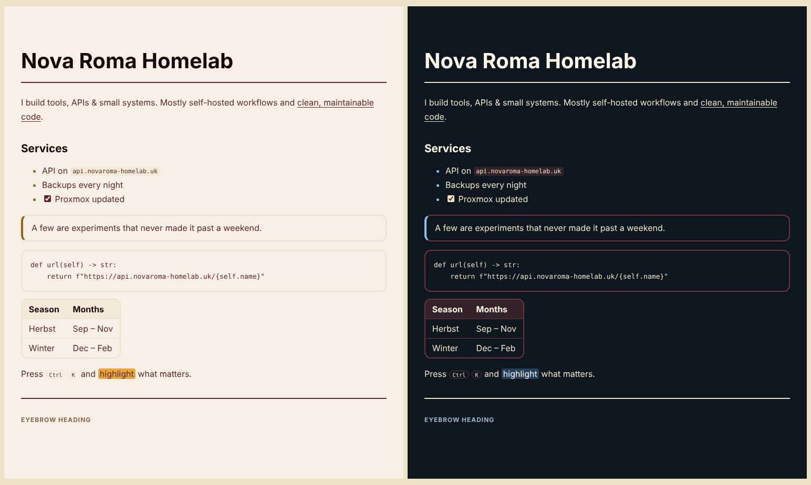

# Novaroma

Colour themes, a file icon theme, a product icon theme, Markdown preview styling and profiles for VS Code, built from the Nova Roma design system of [novaroma-homelab.uk](https://novaroma-homelab.uk): burgundy `main`, cream `accent`, near-black `text`, and five seasons.



## Colour themes

There are 20 colour themes: five seasons, each in four variants.

The seasons are **Standard** (the live site), **Frühling** (blush ground, cherry-blossom highlight), **Sommer** (sunlit ground, sun highlight), **Herbst** (warm paper ground, amber highlight) and **Winter** (frost ground, ice highlight).

The four variants:

- **Light**: chrome (title bar, activity bar, side bar, tab strip) in cream `accent` with burgundy `main` ink, editor on the season's light ground.
- **Light Swapped**: `main` and `accent` exchanged, so the chrome is burgundy with cream ink.
- **Dark**: the Nova Roma dark theme, dark-burgundy chrome with cream ink on the season's dark ground.
- **Dark Swapped**: cream chrome with burgundy ink on the dark ground.



### How colour is used

The brand core stays the same all year; only the ground, `muted` and the season highlight change, as in the design system.

- The status bar is the season mark: a `season` fill with `main` ink.
- The active tab sits on the editor ground with a `season-ink` rule on top, like an active tab on the site.
- Selections, search matches and the selected row in lists use the `season` fill. In Standard Light the season fill equals the cream chrome, so the selected row inverts instead (burgundy fill, cream text), like a hovered button.
- Buttons follow the site's pill button: `accent` fill with `main` text, hovering to `main` with `bg` text.
- Borders are soft `accent` lines and there are no shadows anywhere, as on the site.
- Focus outlines use `text` (the system's `focus-ring`).

### Syntax

- Plain code, variables and properties: `main`.
- Function declarations: `text`, bold. Function calls: `text`.
- Classes and types: `main`, bold; built-in types `main` italic.
- Keywords: `season-ink`, control flow (`if`, `for`, `return`, `import`) bold. In Standard Dark, where `season-ink` equals `main`, keywords use `sv-amber`.
- `self` / `this`, decorators and attributes: `season-ink`, italic.
- Strings: `sv-forest` in light, the Frühling particle green in dark.
- Numbers, constants, booleans and escapes: Winter `season-ink` (blue) in light, the Winter ice fill in dark. In the Winter themes they switch to the Frühling pink so they stay distinct from the blue keywords.
- Comments, operators and punctuation: `muted`, comments italic.
- Errors, warnings and info: the Frühling, Herbst and Winter season inks.

The terminal's 16 ANSI colours are mapped to the same inks.

### Accessibility

Every syntax colour, every text/background pair in the chrome and the status bar reaches at least 4.5:1 (WCAG 2.2 AA). Line numbers and control indicators reach at least 3:1. In the cream chrome the season inks only reach about 4.0:1, so git file decorations there use deeper tokens from the same system: `sv-forest` (added), the autumn bark brown (modified), the Frühling dusk rose (deleted) and the Winter night blue (renamed). Git status is never colour alone; VS Code also shows the letter (M, U, D, R).

## Icon theme

**Novaroma Icons** draws every file and folder in the Nova Roma line style: a rounded 2px outline around a filled ground, cream in light themes and dark burgundy in dark themes, so the icons stay visible on cream, burgundy and dark chrome alike. The file type is marked by a glyph or a short label in one of the season inks. The workspace root folder carries a small amber dot.



It covers about 45 file types (Python, C#, C/C++, JavaScript, TypeScript, HTML, CSS, JSON, YAML, TOML, SQL, CSV/Excel, Markdown, PDF, Word, PowerPoint, images, audio, video, archives, shell scripts, Docker, git, `.env`, lock files, package manifests and more) and 15 special folders (`src`, `.git`, `.vscode`, `node_modules`, `.venv`, `docs`, `tests`, `assets`, `scripts`, `dist`/`build`, `data`, `secrets`, `docker`, `web`, `schule`/`ims`). Every other file and folder gets the plain Novaroma document or folder.

## Product icon theme

**Novaroma Product Icons** redraws VS Code's own interface icons in the same line style: rounded 2px strokes, round ends, no fills except where a state needs one (a toggled layout, a pinned tab, a dirty dot). It covers 97 icons: the activity bar (Explorer, Search, Source Control, Run and Debug, Extensions, Testing, Remote, Accounts, Manage), tree arrows, the close, split, more and filter buttons, new file and new folder, notifications, git branch and sync, errors, warnings and info, the debug toolbar, terminal and output, and the layout toggles in the title bar. Every other icon stays VS Code's default.

Choose it with **Preferences: Product Icon Theme**; **Novaroma: Apply Theme Now** selects it automatically unless `novaroma.setProductIconTheme` is off. Like all product icons, they take their colour from the colour theme.



## Markdown preview

While a Novaroma colour theme is active, the Markdown preview uses the Nova Roma web style: a 2.5rem `h1` with the 2px `main` rule under it, `section-title` `h2`, uppercase eyebrow `h4`, 1.7 line height, outlined code blocks, blockquotes and tables with soft `accent` lines and rounded corners, inline code as a cream chip, list markers in `season-ink`, `<mark>` in the season fill and pill-shaped `<kbd>`. Colours come from the active theme, so every season and light/dark variant applies automatically. With other colour themes the preview is unchanged.



## Seasons, light/dark and swapped

The extension switches the theme for you:

- **Automatic season** (default): Frühling March–May, Sommer June–August, Herbst September–November, Winter December–February. It changes on its own when a new season begins.
- **Light / dark**: follow the system (default), or always light, or always dark.
- **Normal / swapped** chrome.

Click the season name in the status bar, or run **Novaroma: Open Menu** from the Command Palette. The single commands are **Novaroma: Choose Season…**, **Novaroma: Choose Light / Dark…**, **Novaroma: Toggle Swapped Colours** and **Novaroma: Apply Theme Now**.

Every time the theme is applied, `workbench.preferredLightColorTheme` is set to the light version and `workbench.preferredDarkColorTheme` to the dark version of the same season and variant (for example Novaroma Herbst Light and Novaroma Herbst Dark), so turning on **Window: Auto Detect Color Scheme** later switches between the matching pair.

If you pick a Novaroma theme by hand in **Preferences: Color Theme**, the extension takes that as your new choice instead of switching back.

### Settings

- `novaroma.season`: `auto`, `standard`, `fruehling`, `sommer`, `herbst` or `winter` (default `auto`).
- `novaroma.appearance`: `system`, `light` or `dark` (default `system`).
- `novaroma.variant`: `normal` or `swapped` (default `normal`).
- `novaroma.autoApply`: switch automatically when the season or these settings change, only while a Novaroma theme is in use (default `true`).
- `novaroma.setIconTheme`: also select Novaroma Icons when applying (default `true`).
- `novaroma.setProductIconTheme`: also select Novaroma Product Icons when applying (default `true`).
- `novaroma.showStatusBarItem`: show the season in the status bar (default `true`).

## Profiles

Run **Novaroma: Apply Profile…** to apply a set of editor settings together with the theme:

- **Novaroma Standard**: theme and icons, plus the shared Novaroma editor feel (smooth cursor, bracket-pair colours, rounded selection, indent guides in the tree).
- **Novaroma Focus**: no minimap, no breadcrumbs, a single tab, gutter-only line highlight.
- **Novaroma Presentation**: 18px editor and 16px terminal text, 1.7 line height, no minimap.
- **Novaroma Compact**: 12px text, a tighter tree, no minimap.

Before a profile is applied, the settings it changes are saved; **Novaroma: Undo Last Profile** (or **Undo** in the notification) restores them.

The same four profiles also come as real VS Code profiles in the `profiles` folder of the source (`Novaroma-Focus.code-profile` and so on). Import one with **Profiles: Import Profile…**. VS Code installs extensions per profile, so install the Novaroma VSIX again inside the new profile after importing it.

## Install

In VS Code open the Extensions view, click **…**, choose **Install from VSIX…** and select the `.vsix` from the latest GitHub release. Then run **Novaroma: Apply Theme Now**, or choose a theme with **Preferences: Color Theme** and **Novaroma Icons** with **Preferences: File Icon Theme**.

## Build from source

The themes, icons, previews and profiles are generated from the design tokens in `build/tokens.py`:

```sh
python3 build/build.py      # colour themes and icon theme
python3 build/check.py      # contrast check
python3 build/preview.py    # preview images (needs rsvg-convert and Pillow)
python3 build/product_icons.py  # product icon font (needs picosvg, fonttools, skia-pathops)
python3 build/profiles.py   # .code-profile files
npx @vscode/vsce package --no-rewrite-relative-links
```

The logo is the Nova Roma Home Lab mark, used as it is.
